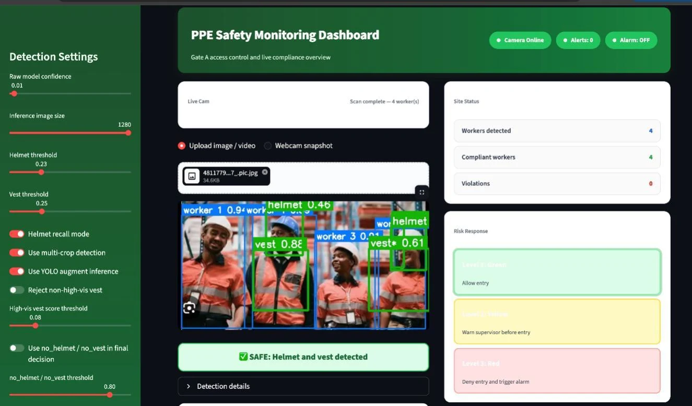

# PPE Safety Monitor | 个人防护装备检测

A computer-vision application prototype with YOLO inference, multi-crop recall, class-specific thresholds and a Streamlit dashboard.

**[观看检测效果与技术注解](https://leoz-svg.github.io/ppe-safety-monitor/) · [作品集](https://leoz-svg.github.io/ai-project-portfolio/)**



## 项目与贡献

识别 helmet、no_helmet、vest、no_vest 四种状态，将检测结果接入图片 / 视频界面、规则提示与当前扫描 CSV 导出。

我的主要贡献：Faster R-CNN / SSD300 训练和测试，参与三模型比较，Streamlit 界面设计调试，以及漏检和错误关联问题的分析。团队成员为 Haoran Zheng、Yanyuan Liu、Yao Zhang；最终部署的 YOLOv8s 训练由团队协作完成。

## 先看效果，再运行

公开页面提供原项目实际检测视频、原报告截图、模型结果和失败案例注解。**网页不提供在线推理，也不会假装处理访客图片。**完整应用在 Python 环境运行。

本仓库包含提交应用中的 `app.py`、`models/best.pt` 以及运行依赖。Faster R-CNN / SSD 训练 Notebook 不在所提供应用包中，不能据此重现完整训练实验。

```sh
python -m venv .venv
# Windows: .venv\Scripts\activate
# macOS/Linux: source .venv/bin/activate
pip install -r requirements.txt
streamlit run app.py
```

在项目根目录运行。首次安装 PyTorch 等依赖可能需要较长时间。应用会在本地生成 results/ 和 incident_log.csv，这些运行输出已排除于源码版本管理。模型来自该项目的提交文件；不要替换为不可信来源的权重文件。

## 推理流程

输入 → 整图和可选区域裁剪 → YOLO → 将框映射到原图 → 同类别 NMS → 类别阈值与可选颜色过滤 → 装备位置分组 → 风险规则 → 展示与导出。

关键函数：`infer_one` 处理坐标还原；`raw_detect` 控制裁剪；`nms` 去重；`filter_detections` 记录接受/忽略原因；`cluster_detections_into_workers` 使用横向中心分组；`run_detection` 串联流程。

## 报告指标（非本次重新测量）

| 模型 | Precision | Recall | mAP@50 | mAP@50–95 | FPS |
|---|---:|---:|---:|---:|---:|
| YOLOv8s | 0.804 | 0.818 | 0.838 | 0.5666 | 未填写 |
| Faster R-CNN | 0.5601 | 0.7802 | 0.6976 | 0.3945 | 40.01 |
| SSD300 | 0.7312 | 0.5307 | 0.6338 | 0.3361 | 87.24 |

来源：Project-FinalReport，第 14 页。输入规模、设备和计时范围需统一，才能比较端到端速度。报告中实际图像数为训练 15,180、验证 3,554、测试 1,946。

## 当前版本边界

- 仓库是 Helmet Recall 版本，**只加载 best.pt**。报告截图含其他版本的人员检测展示，不能认为本仓库实现了独立 COCO 人员检测。
- “Worker”来自装备框横向位置聚类，不是稳定人员身份或跟踪。背景装备和拥挤场景可能导致错误关联。
- Webcam 是快照。视频分帧处理，汇总取末帧。CSV 覆盖保存当前扫描结果，不是完整事件历史。
- 风险分来自规则，不是模型预测事故概率；Gate 状态是界面模拟，没有实体门禁接口。
- 阈值变化后的重推理、无人员输入和多人关联需要进一步完善。本项目不能直接用于真实安全放行。

## 可继续验证的方向

固定单人/多人/遮挡/远景/无人物测试集，对比阈值、多裁剪与关联逻辑；同时记录检测指标、错误放行、错误报警和端到端延迟。

## 发布说明

GitHub Pages 从 `main:/docs` 发布。公开截图提取自团队报告；视频为原应用输出并仅做浏览器兼容转码。未公开学号、简历联系方式、虚拟环境和原始历史日志。第三方库、数据与素材保留其各自权利，部署代码不更改原项目的权属。
